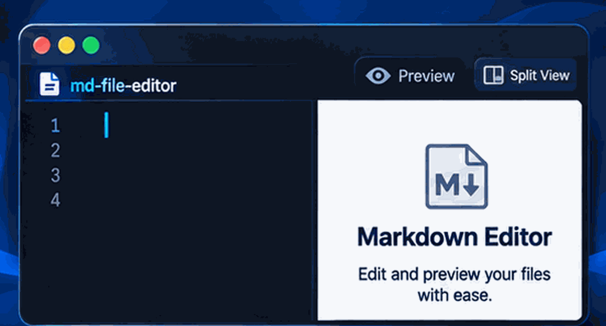
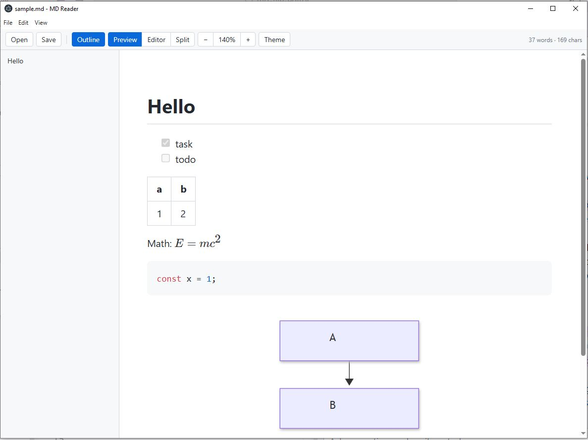

<p align="center">
  
</p>

<h1 align="center">MD File Editor</h1>

<p align="center">
  A free, open source desktop Markdown reader and editor for Windows, macOS and Linux.<br>
  Works offline. No account. No subscription.
</p>

<p align="center">
  <a href="https://github.com/vladano/md-file-editor/releases/latest">
    
  </a>
</p>

<p align="center">
  <a href="https://github.com/vladano/md-file-editor/releases/latest"></a>
  <a href="https://github.com/vladano/md-file-editor/actions/workflows/build.yml"></a>
  <a href="https://github.com/vladano/md-file-editor/actions/workflows/ci.yml"></a>
  <a href="LICENSE"></a>
  
</p>

- Live preview, editor and split view
- Math (KaTeX), Mermaid diagrams, syntax highlighting, tables, task lists, footnotes
- Export to HTML and PDF
- Works offline, no account needed

## Live preview with Mermaid and math

Edit Markdown with an instant split-view preview, including Mermaid diagrams and mathematical formulas.



<p align="center">
  
</p>

PDF export keeps headings with their content and avoids splitting code blocks and tables. See the [example PDF](docs/examples/pdf-export-sample.pdf) and its [Markdown source](docs/examples/pdf-export-sample.md).

## Why this one?

| | MD File Editor | Typora | Obsidian | MarkText |
|---|---|---|---|---|
| Price | Free | Paid (trial available) | Free | Free |
| Open source | Yes (MIT) | No | No | Yes (MIT) |
| Works offline | Yes | Yes | Yes | Yes |
| Account required | No | No | No | No |
| Opens a single `.md` file directly | Yes | Yes | No, works on a vault (folder) | Yes |
| Built-in Mermaid and KaTeX | Yes | Yes | Yes | Yes |

MD File Editor is a small app that does one job: open a Markdown file, read it nicely and edit it with a live preview. It is free, open source and needs no account. There is no vault to set up and no license to buy.

Comparison based on public information about each app at the time of writing. Check each project for current details.

## Features

Preview / editor / split view, outline panel, zoom in/out, light/dark theme, find, GitHub-style tables, task lists, footnotes, emoji, KaTeX math, Mermaid diagrams, syntax highlighting, live reload on file change, drag & drop, export to HTML and PDF.

## Download and install

Download the latest version for your OS from the [Releases page](https://github.com/vladano/md-file-editor/releases/latest).

| OS | Download |
|---|---|
| Windows | Installer (`Setup ... .exe`) or portable `.exe` |
| macOS | `.dmg` or `.zip` (Intel and Apple Silicon) |
| Linux | `.AppImage`, `.deb` or `.tar.gz` |

You can also [build the binaries yourself](docs/BUILDING.md).

Each release includes a `SHA256SUMS.txt` file so you can verify your download.

The builds are not code signed yet, so your OS may show a warning on first launch:

- Windows: SmartScreen shows "Windows protected your PC". Click "More info" > "Run anyway".
- macOS: Gatekeeper blocks the first launch. Right-click the app and choose Open, or run `xattr -cr "/Applications/MD File Editor.app"` after copying it to Applications.
- Linux: `chmod +x` the AppImage, or install the `.deb` with `sudo apt install ./file.deb`.

## Quick start (from source)

Requires [Node.js](https://nodejs.org) 20 or newer (includes npm).

```bash
git clone https://github.com/vladano/md-file-editor.git
cd md-file-editor
npm install
npm start
```

To open a specific file: `npx electron . path/to/file.md`. To run the unit tests: `npm test`.

## Keyboard shortcuts

| Shortcut | Action |
|---|---|
| Ctrl+O / Ctrl+S / Ctrl+Shift+S | Open / Save / Save As |
| Ctrl+1 / Ctrl+2 / Ctrl+3 | Preview / Editor / Split view |
| Ctrl+B | Toggle outline |
| Ctrl+T | Toggle theme |
| Ctrl+F | Find |
| Ctrl+= / Ctrl+- / Ctrl+0 | Zoom in / out / reset |
| Ctrl+mouse wheel | Zoom |

On macOS use Cmd instead of Ctrl.

## Documentation

- [Building binaries](docs/BUILDING.md): Windows, macOS, Linux, WSL 2, Docker, GitHub Actions, build commands and the app icon.
- [Testing](docs/TESTING.md): unit tests and the manual test checklist.
- [Contributing](CONTRIBUTING.md), [Changelog](CHANGELOG.md), [Security policy](SECURITY.md).

## Report a bug or request a feature

- Found a bug or want a feature? [Open an issue](https://github.com/vladano/md-file-editor/issues/new/choose) and pick the bug report or feature request template.
- Have a question or an open-ended idea? Start a thread in [Discussions](https://github.com/vladano/md-file-editor/discussions). See [how to report bugs](https://github.com/vladano/md-file-editor/discussions/8).
- Security problem? Do not post it publicly. Use the [private vulnerability report](SECURITY.md).

## License

MIT License. Free to use, copy, modify and distribute for personal and commercial purposes. Copyright (c) 2026 [vladano](https://github.com/vladano).

The copyright notice and the permission notice in the [LICENSE](LICENSE) file must be kept in all copies or substantial portions of the software.

This app was created using the [AWS Kiro](https://kiro.dev) IDE environment.
